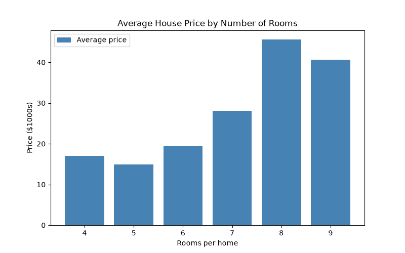
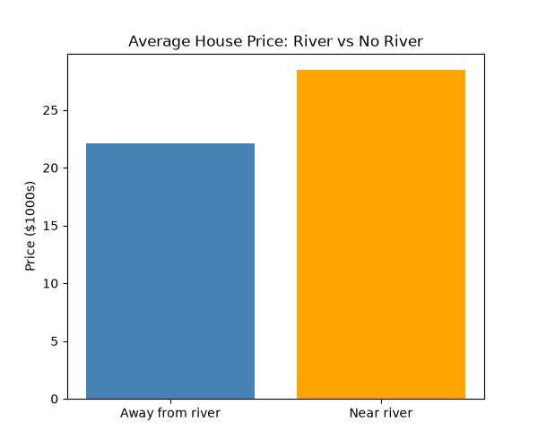
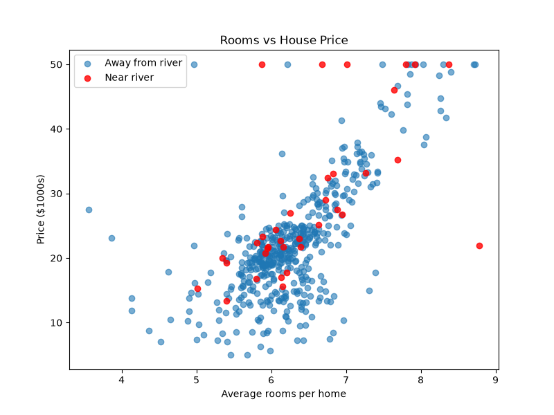
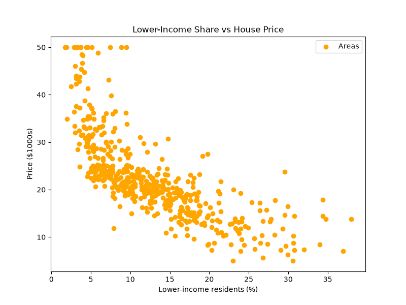
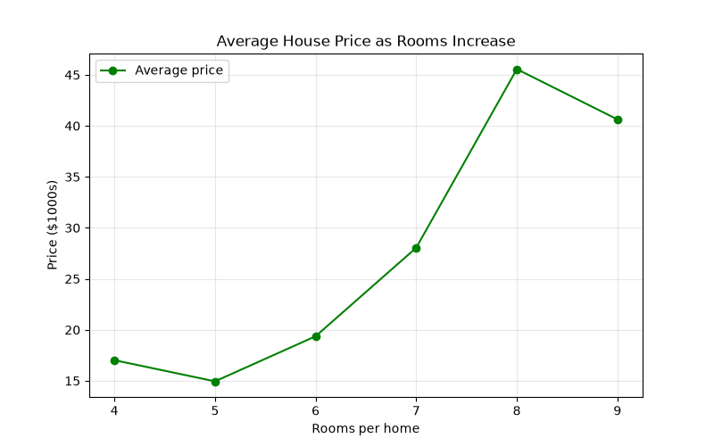

# Task 3: Basic Data Visualization

## Objective
Create bar plots, line charts and scatter plots to show the distribution of, and relationships within, the house data. Add titles, axis labels and legends, and save the plots as images.

## Dataset
House prediction data with 506 rows and 14 columns about city areas, such as the number of rooms, the share of lower-income residents, whether the area is near the river, and the median house price.

## What I Did
1. Loaded the data and gave each column a name
2. Checked the size of the data and looked for missing values
3. Made bar plots, scatter plots and a line chart
4. Added a title, axis labels and a legend to every chart
5. Saved every chart as an image in the `plots` folder

## Charts

### Bar plot: average price by number of rooms

### Bar plot: river vs no river

### Scatter plot: rooms vs price

### Scatter plot: lower-income share vs price

### Line chart: average price as rooms increase

## Summary
- The data has 506 rows and 14 columns, with no missing values.
- The bar plots showed that as the number of rooms increases, the price also increases, so the bars go up from left to right. They also showed that areas near the river are more expensive than areas far from the river.
- The scatter plots showed that areas away from the river are far more numerous and have a lower average price, while areas near the river are few and have a higher average price. The lower-income share plot showed that most areas are concentrated on the left side of the graph, where the share is lower.
- The line chart showed that the average price goes up from left to right as the number of rooms per home increases.
- Every chart has a title, axis labels and a legend, and was saved as an image in the `plots` folder.

## Tools
Python, pandas, matplotlib