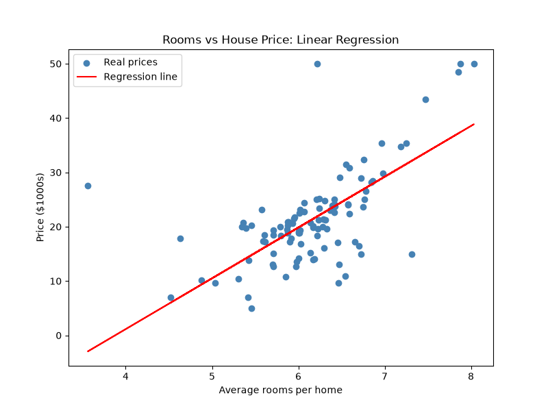

# Level 2, Task 1: Regression Analysis

## Objective
Use simple linear regression to predict one value from another, split the data into training and testing sets, and evaluate the model.

## Dataset
House prediction data with 506 rows and 14 columns. I used the average number of rooms to predict the median house price.

## What I Did
1. Loaded the data and checked for missing values
2. Split the data into 80% training and 20% testing
3. Fitted a linear regression model with scikit-learn
4. Read the coefficient and intercept
5. Evaluated the model with R-squared and mean squared error
6. Drew the regression line on a chart

## Results
- Coefficient: 9.35
- Intercept: -36.25
- R-squared: 0.37
- Mean squared error: 46.14

## Main Findings
- for the coefficient being a positive and bigger number it gave results fairly accurate though with much bigger errors.
- the second inspection gave the coefficient as -0.97 and more accurate results than the first run indicating that as the coefficient decreases, the more accurate the result set will become.
- the model is not that good since the data it fed on and make predictions was not that much accurate because some instances were ignored like room types and location which would increase the price of the rooms.
feeding the model more accurate results will otherwise make it predict better the prices.

## Tools
Python, pandas, scikit-learn, matplotlib