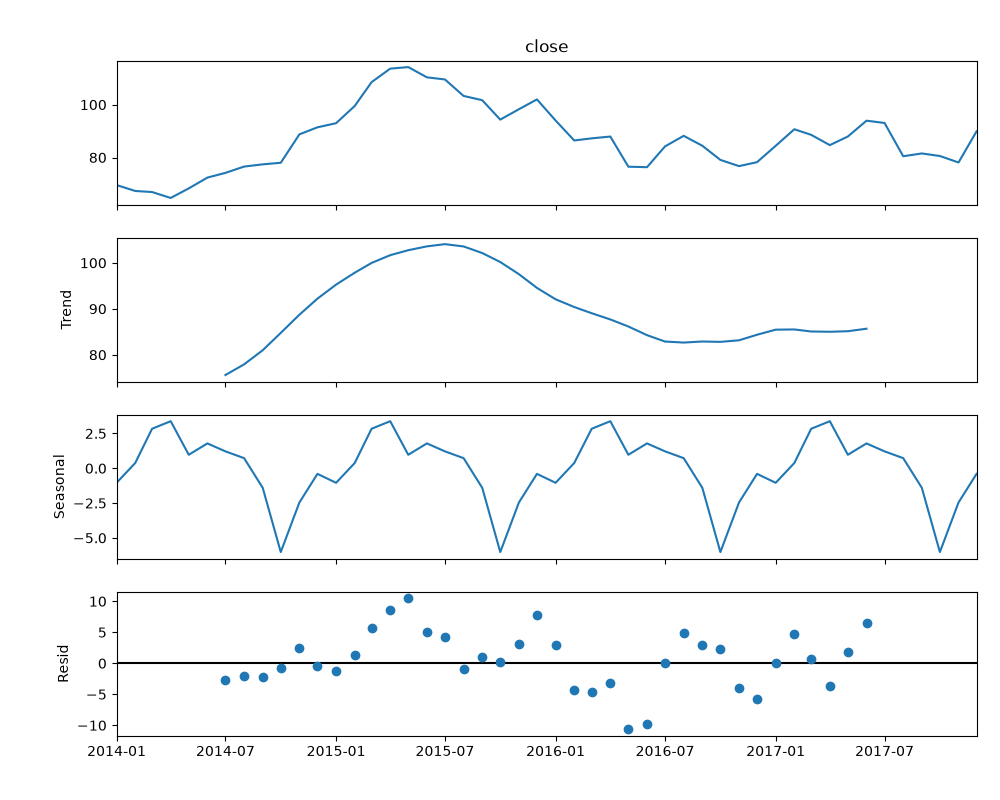
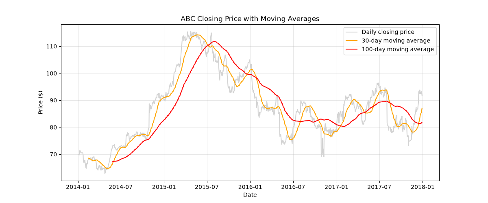

Task 2: Time Series
Aim:

Produce a time series plot. Decompose into components and smooth with a moving average.
Data

The data contains open, high, low, close and volumes for many stocks. Data for the closing price of ABC from 2nd Jan 2014 to 29 th Dec 2017 (4 years). There were no missing values.
Analysis

1. Load data, select one stock (ABC).
2. Convert dates to actual dates, plot closing price.
3. Create monthly averages for each price, decompose into components.
4. Calculate 30 & 100 day moving averages.

Plots
Closing price of Stock

Components

Moving Averages

Key observations

Trend: The closing price increased to a maximum value of ~$115 in spring 2015, from ~$70 in early 2014. In mid 2016 the price dropped to ~$75. From this point the closing price fluctuated from ~$75 to ~$95 until the end of 2017.
Trend: Increased until mid 2015, decreased until mid 2016 and has been relatively stable since.
Seasonality: There is a small seasonal pattern. Prices are slightly higher than the trend in spring and much lower than the trend in October. However this pattern is very small relative to the price.
Residuals: Residuals appear to be fairly randomly distributed around zero. They have larger values (up to $10) in 2015 and 2016, where the price changed most rapidly.
Moving Averages: Moving averages have smoothed out short term fluctuations. The 100 day moving average is the smoothest, showing the general trend of the data. It does not react as quickly as the 30 day moving average.
Limitations

Only 4 years of data means the seasonal pattern may be unreliable as it is only repeated 4 times. We cannot predict future prices from previous prices.
Software

Python, Pandas, Matplotlib, Statsmodels.
@titustrevor-1