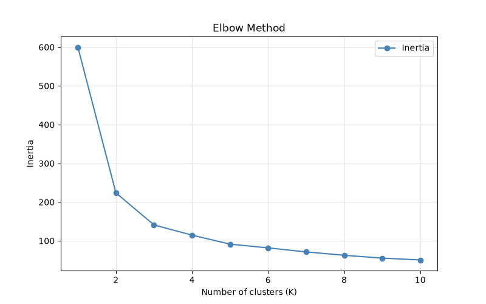
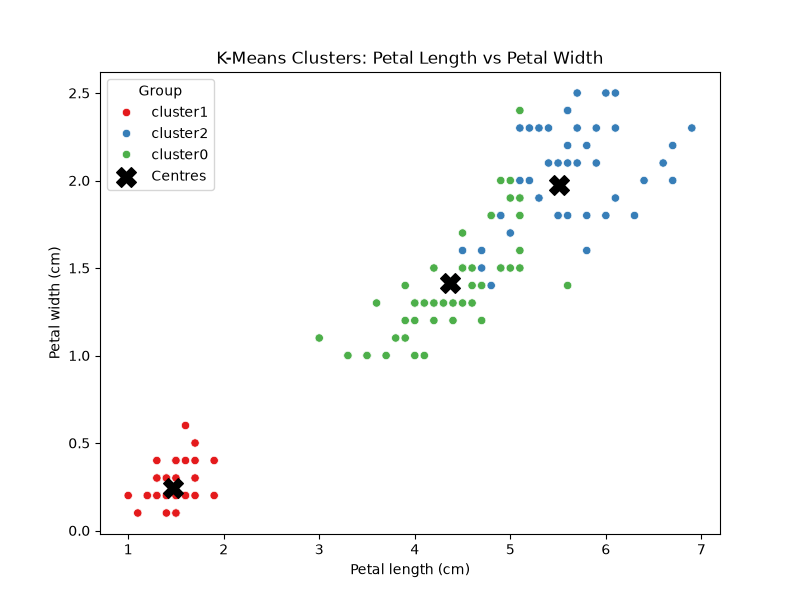
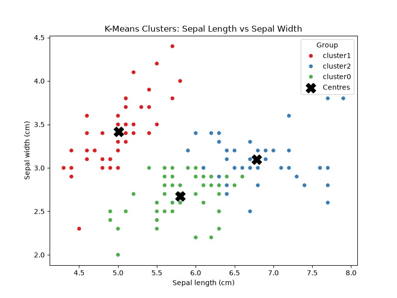

Task 3: Clustering
Aim

To group the data using k-means clustering. Data normalisation was conducted. We found how many clusters to use using the elbow method, and plotted the grouped data on a 2D scatter plot.
Data

We had 150 entries of iris flowers. We only considered the measurements (petal length, petal width, sepal length, sepal width) for clustering. We ignored the species in order to allow the algorithm to identify any groupings in the data itself. We then used the species to compare our results.
Process

Missing data was checked. The measurement data was normalised using StandardScaler. The optimal number of clusters was found using the elbow method. 3 clusters were chosen. K-means was performed and cluster labels were added. We calculated the average size of clusters. Plots of each cluster were made, with the cluster centres labelled. Finally, the clustered data was compared to species.
Images
Elbow method:

Petal size clusters:

Sepal size clusters:

Results
Cluster | Petal length | Petal width | Description
---|---|---|---
Cluster 1 | ~1.5cm | ~0.25cm | Smallest
Cluster 0 | ~4.4cm | ~1.4cm | Medium sized
Cluster 2 | ~5.5cm | ~2.0cm | Largest
Note: Cluster numbering is arbitrary.
Key findings
Number of clusters: Based on the elbow method, there appears to be a ‘bend’ in the data when there are 3 clusters, so we decided to use 3 clusters.
Small, medium and large clusters: The data appears to have 3 clusters.
Best separation between groups occurs based on petal size: Cluster 1 is very distinct from clusters 0 and 2 are close to each other however there is only minor overlap between them.
Less distinct separation between groups based on sepal size: Whilst cluster 1 remains largely distinct, clusters 0 and 2 have a great deal of overlap. Using sepal size alone, it is difficult to distinguish between clusters 0 and 2.
Matching with actual species: The small petal cluster matches with setosa. However a few flowers have been misclustered within the other 2 clusters, since versicolor and virgnica look very similar.
Limitations
As K means requires a number of clusters to be decided upon, and the elbow method provides an approximate answer rather than a precise one.
Groups 0 and 2 overlapping shows that based on just these measurements, it can be difficult to distinguish between certain flowers.
Software

Python, Pandas, Scikit-learn, Matplotlib, Seaborn